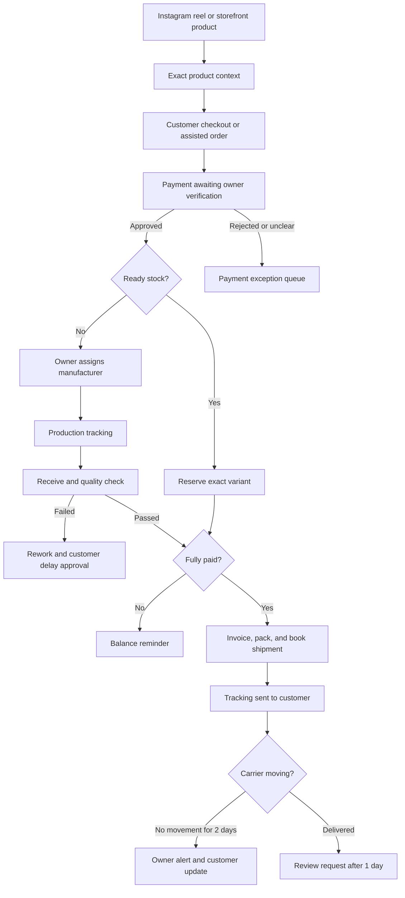

# VAIDHURYA Operations Automation Plan

## Purpose

Read the [business operations reference](./business-operations-reference.md) and [automation requirements/decision register](./business-automation-requirements.md) for owner-confirmed facts and unresolved choices. This document proposes an execution approach; vendor recommendations, pilot plans, and historical alternatives are not confirmed adoption or production status.

This is the proposed execution plan for reducing operational errors and manual follow-up across orders, inventory, fulfillment, delivery, customer communication, manufacturing, invoicing, and reporting.

The immediate priority is deliberately narrow:

1. establish one authoritative order record;
2. make packing and dispatch reliable;
3. monitor every shipment until delivery;
4. load usable inventory quickly; and
5. add further automation only after this operating core is stable.

The existing VAIDHURYA storefront, seller console, Supabase/Postgres implementation, inventory ledger, shipment contract, and notification adapters provide the first-party foundation. An ERP pilot does not change production authority. Any later cutover assigns exactly one system authority over each business fact.

## Platform decision after total-cost review

The recommendation is **managed open-source ERPNext on Frappe Cloud as the immediate operational core**, connected progressively to the existing `vaidhurya.com` storefront. The existing custom platform remains the long-term owned customer and seller experience. Excel is retained for initial imports, controlled bulk corrections, reports, and offline/export copies; it is no longer recommended as the live order database.

This conclusion is based on total operating cost rather than licence price alone:

| Option | Cash cost | Setup burden | Continuing burden | Fit for VAIDHURYA | Decision |
| --- | --- | --- | --- | --- | --- |
| Excel + OneDrive | Microsoft 365 subscription plus the cost of designing and maintaining the workbook | Low for manual tracking; high once safe website/payment/carrier synchronization is added | Formula protection, reconciliation, version conflicts, duplicate entry, and owner time | Useful bridge/reporting tool, but weak as an automated transaction system | Keep, but not as operational authority |
| ERPNext on managed Frappe Cloud | Site hosting starts at US$5/₹410 per month; budget for a higher plan after a real-volume trial and for one-time configuration | Moderate, mostly configuration and data import | Managed upgrades, monitoring, restores, and offsite backups; business configuration still needs ownership | Strong match for orders, stock, purchases/manufacturers, advances, receivables/payables, tax, audit trail, and APIs | **Pilot first** |
| ERPNext self-hosted on a VPS | Software licence is free plus server, backup storage, mail, monitoring, and administrator time | High | VAIDHURYA becomes responsible for patches, failed upgrades, security, database recovery, and uptime | Same functional fit, but conflicts with the goal of minimal technical maintenance | Reject initially; retain as an exit option |
| Odoo Online/Enterprise | Per-user subscription; external API/customisation requires the more expensive Custom route | Medium to high; implementation is normally a separate project | Vendor configuration, partner/customisation, and per-user costs | Capable, polished, and India-localized, but heavier and costlier than needed for one operator | Keep as fallback only if ERPNext pilot fails usability/accounting tests |
| PrestaShop | Core software is free; hosting, paid modules, upgrades, security, and integration work are additional | High because it duplicates the existing storefront | PHP/MySQL hosting, module compatibility, security, and separate ERP/accounting processes | E-commerce storefront, not a complete manufacturing/order/accounting operating system | Reject |
| Baserow/NocoDB/other database builders | Free or inexpensive starting tier | Deceptively high: tables are quick, but order state, inventory reservation, accounting, approvals, and reconciliation must be designed | VAIDHURYA owns the application logic and integration maintenance | Better than Excel for structured data, but effectively another custom build | Reject as the primary ERP |
| Existing VAIDHURYA platform only | Current production infrastructure can begin around Supabase Pro at US$25/month plus Cloudflare usage and messaging/payment providers | Highest remaining implementation effort, despite substantial code already existing | Lowest vendor lock-in, but all business logic, monitoring, support, and compliance remain first-party work | Best final fit and ownership | Continue incrementally; do not wait for it before controlling operations |

Published hosting/subscription prices are only baselines and can change. Implementation quotes must be compared against the same written scope. For VAIDHURYA, the most important hidden-cost calculation is:

`monthly manual cost = avoidable owner hours per week × 4.33 × value of one owner hour`

For illustration—not a price claim—even five avoidable hours a week valued at ₹500/hour costs about ₹10,825/month. That is already much larger than managed ERP hosting. Optimizing only for a free licence would therefore be false economy.

### Why managed hosting, not raw self-hosting

Data ownership and server operation are different decisions. VAIDHURYA can own its records, identifiers, attachments, exports, and custom code without personally operating Linux and databases. Frappe Cloud advertises automated/offsite backups, monitoring, restores, upgrade controls, and disaster-recovery support. Start on a managed site plan, export the database and files on a schedule, and preserve a tested path to self-host later.

No architecture can promise that data will "never" be lost. The practical target is low recovery risk: production database, provider-managed backups, independent encrypted exports, attachment copies, and quarterly restore tests.

### Required ERPNext proof-of-fit gate

Use a 14-day sandbox with copied—not live—data. Do not commit to a large implementation until the owner and CA approve these tests:

1. import 35–40 product designs and exact material/size variants;
2. process an in-stock order and reserve the correct variant;
3. process a made-to-order item with 30–50% advance and balance-before-dispatch;
4. assign a manufacturer, promised date, cost, payable, receipt, delay, and rework;
5. capture estimated versus actual silver/gold weight and freeze/recalculate price under the documented rule;
6. complete QC approval, shipment, stalled-tracking alert, delivery, and review request;
7. generate a CA-approved GST invoice with HSN, purity, weight, hallmark information, and CGST/SGST or IGST treatment;
8. export customers, products, orders, ledger entries, and attachments, then restore a test copy;
9. confirm that Telugu/Hindi customer messages remain in the messaging layer even if ERP records use normalized internal values;
10. confirm acceptable daily usability on phone and desktop for the sole owner.

If these tests pass, ERPNext becomes the single operational writer after a reconciled cutover. If they fail materially, compare the specific failing workflows against a managed Zoho/Odoo trial and the existing seller platform before selecting the alternative. Do not default to rebuilding an entire ERP.

### First-year cost comparison and purchasing gate

Public price check: 24 October 2026. Amounts below exclude tax, implementation, integrations, external messaging, shipping, payment fees, and overages. They are subscription baselines, not complete project quotations.

| Configuration | Published recurring baseline | Twelve-month baseline | Main additional cost |
| --- | --- | --- | --- |
| Existing licensed Excel | Potentially no incremental licence purchase | Depends on current licence | Workbook design, manual work, synchronization maintenance |
| Microsoft 365 Business Standard without Teams | ₹665/user/month, annual commitment | ₹7,980 for one user | Building and maintaining operational automation |
| Microsoft 365 Business Standard with Teams | ₹860/user/month, annual commitment | ₹10,320 for one user | Same automation work; Teams is unnecessary for this workflow |
| Frappe Cloud entry site | From ₹410/month | From ₹4,920 | Implementation, suitable production resources/support, integrations |
| Zoho Books Standard | ₹749/organization/month, annual billing | ₹8,988 | Advanced operational workflows and automation may need higher tiers |
| Zoho Books Professional | ₹1,499/organization/month, annual billing | ₹17,988 | Custom functions/webhooks are listed in Premium and above |
| Zoho Books Premium | ₹2,999/organization/month, annual billing | ₹35,988 | Carrier and storefront integrations still require validation |
| Existing platform: Supabase Pro | From US$25/month | From US$300 | Application hosting/usage, independent backup copies, development and support |

Odoo's official page returned US-dollar regional prices during this research, so an Indian rupee quote is deliberately not inferred from third-party trackers. Its official plan table places external API access in Custom; Odoo.sh hosting is additional. Obtain an India checkout quote including renewal price before comparing it with ERPNext.

Frappe distinguishes hosting from implementation, and its product warranty excludes functional support. Obtain a fixed-scope quote for import, configuration, CA invoice review, owner training, integration, and post-launch fixes. Require recurring support and renewal charges separately. A low hosting price is insufficient evidence of low total cost.

Choose the lower three-year total that passes the workflow tests:

`setup + migration + integration + 36 × (hosting + licences + support + backup + owner administration time) + exit/export cost`

Start with standard configuration and custom fields; avoid core ERP forks. Compare two fixed-scope setup quotes before a paid implementation commitment. Do not subscribe annually before the pilot proves usability. Automatic carrier tracking and Instagram/WhatsApp replies are separate integration work, not included merely by installing ERPNext.

## Fastest-production decision — rent the workflow, then absorb it

The fastest safe rollout is **not** to finish every custom module before using the system. It is also not to move the storefront to Shopify or to assemble the business in spreadsheets. VAIDHURYA should temporarily rent mature operational capabilities, preserve exportable identifiers and records, and replace each rented capability only after the equivalent first-party workflow is verified.

### Recommended bridge stack

| Business capability | Start now | Why this is the fastest acceptable bridge | Later ownership path |
| --- | --- | --- | --- |
| Order, variant inventory, payments, packing, purchase orders, manufacturer records, and accounting | ERPNext on managed Frappe Cloud, after the proof-of-fit gate | One connected transaction model replaces duplicate spreadsheet entry and adds audit history, receivables/payables, stock and manufacturing/vendor tracking | Keep ERPNext while it reduces work; progressively expose its APIs through the VAIDHURYA seller console, then migrate a bounded module only when first-party parity is proven |
| GST invoices, expenses, payments, and CA access | ERPNext India compliance pilot, validated by the CA; use Zoho Books only if that validation fails | Avoids two ledgers while retaining a tested fallback with mature India GST workflows | Never run two statutory accounting authorities for the same period; cut over at a documented fiscal boundary or with CA-approved opening balances |
| Jewellery delivery | BVC eSHIP as the first provider to validate; insured India Post only as an explicitly verified fallback | BVC is purpose-built for gold/silver/jewellery, supports pickup, declared-value cover, tracking, POD, and a prepaid wallet without a monthly commitment | Start with BVC Universe manual booking, then integrate BVC's API into VAIDHURYA after shipment volume and service quality justify it |
| Instagram automation | Interakt Instagram trial for reel-specific comment/DM automation; test against Manychat only if Interakt cannot meet the exact flow | Flat-price, no-code Instagram automation is likely cheaper at VAIDHURYA's high inquiry volume than active-contact pricing | Replace proven flows with the existing Meta webhook/inbox foundation one flow at a time |
| WhatsApp | Preserve the current working Business/API setup initially; add Interakt/AiSensy only after a coexistence and history-retention pilot | Moving the production number too early can disrupt the channel that currently converts buyers | First-party approval inbox and Meta Cloud API become authoritative after template, consent, delivery-receipt, and recovery certification |
| Full or advance payment links | Razorpay Payment Links only where the fee is commercially acceptable | No-code links support expiry, reminders, references, and partial payment and remove screenshot matching | Existing Razorpay integration creates and reconciles links/orders directly |
| Cross-tool automation | Native integrations first; Pabbly/Make only for one proven missing handoff | Fewer moving parts mean fewer silent failures. A generic automation layer is added only when its trigger, retry, owner alert, and reconciliation behavior are specified | Replace stable bridge workflows with audited first-party jobs and webhooks |

### Expected starting software cost

Use trials before annual commitments. Indicative public pricing at the time this plan was reviewed:

- ERPNext managed site trial: 14 days; Frappe Cloud advertises site plans from US$5/₹410 per month and server plans from US$40/₹3,600 per month. Select a production tier only after measuring the trial workload and confirming backup/support terms.
- Excel/OneDrive: use an existing properly licensed account if available. Microsoft 365 Business Basic is web/mobile only; a plan that includes desktop Excel costs more. Do not purchase it merely to operate the ERP.
- Zoho Inventory and Zoho Books remain fallback products, not simultaneous default systems: Inventory Standard is listed around ₹999/organization/month annually; Books Standard around ₹749/month annually or ₹899 monthly.
- Interakt Instagram automation: listed at ₹999/month plus taxes with a trial.
- BVC eSHIP: prepaid/pay-per-shipment onboarding is advertised without a monthly commitment; obtain a written rate and insurance schedule before sending a parcel.
- Razorpay: standard payment-gateway pricing is listed at 2% plus applicable GST; use selectively until its cost is included in pricing.

The operational-core pilot can therefore start near ₹410/month before messaging, shipping, payment fees, taxes, and implementation assistance. This is not a production budget guarantee: compute, support, custom apps, integrations, and backup-retention requirements may require a higher tier. Do not buy Zoho, Odoo, a WhatsApp BSP plan, Shiprocket, Shopify, or a workflow-automation subscription until the relevant pilot proves a need.

### Procured jewellery workbook toolkit — reuse decision

The `All jewellery tools 30` folder contains 31 workbook files, including one exact duplicate of the CRM workbook. They are not a connected system: no workbook contains an external formula link to another workbook. Most carry demonstration businesses, sample customers, sample dates, and sample prices. Using all of them simultaneously would require the owner to re-enter the same product, customer, sale, inventory, and payment facts in several places and would increase error risk.

Reuse the strongest structures and formulas, not the sample records or all 31 files.

| Procured workbook | Decision | Reusable capability |
| --- | --- | --- |
| `Jewelry Business Dashboard.xlsx` | Use only as the visual/dashboard reference | Compact sales, inventory, customer, order, product, and margin overview |
| `Jewelry Order Tracker.xlsx` | Use as the primary order-status model | Order ID, due date, fulfillment stage, payment status, priority, reserved and available-to-sell quantities |
| `Jewelry Inventory Tracker.xlsx` | Use as the inventory-ledger model | SKU, gross/net weight, purity, stock in/out, current quantity, value, reorder status, and movement reference |
| `Sales & Payment Tracker.xlsx` | Use as the payment model | Separate payment receipts, paid total, balance, due date, and overdue calculation |
| `Supplier & Vendor Tracker.xlsx` | Adapt from bulk supplier language to VAIDHURYA manufacturers | Manufacturer master, production/purchase order, promised/actual date, delay variance, payable and payment status |
| `Customer Order Status Tracker.xlsx` | Reuse selected customer follow-up fields | Expected date, priority, dispatch-detail follow-up, and customer-facing status |
| `Customer CRM & Follow-Up Tracker.xlsx` | Defer until order operations are stable | Inquiry source, product interest, lead stage, language, next follow-up, and conversion outcome |
| Pricing, weight, purity, making-charge, stone, wastage, and category calculators | Consolidate into one pricing workspace | Metal, weight, making, stone, wastage, margin, GST, and category-specific calculations |
| Return & Exchange Tracker | Do not enable as a normal workflow | Retain only for owner-approved repair, damage, shipment-loss, and statutory exception cases |
| Standalone dashboards and repeated inventory/sales tabs | Do not operate separately | Use as design/formula references only |

Import/export templates should contain one normalized table for each fact, carrying the authoritative platform record ID:

1. `Products` — internal ID, reel/product URL, category, material, purity, size variants, pricing, made-to-order flag, and lead time.
2. `Inventory` — exact variant, stock in, reservations, stock out, current saleable quantity, location, and last physical count.
3. `Orders` — customer, address, line items, size/customization, payment, production, QC, packing, shipment, and delivery state.
4. `Payments` — receipt/reference, order, expected amount, received amount, verification, balance, and due date.
5. `Manufacturers` — contact, specialty, normal lead time, CAD ownership, quality and delivery history.
6. `Production` — order/line, manufacturer, sent/accepted/promised/received dates, quoted cost, payment, delay and rework.
7. `Shipments` — order, compliant carrier, declared value, insurance evidence, tracking, last event, stalled-days alert, delivery and review follow-up.
8. `Pricing` — silver/gold rules, metal rate, estimated/actual weight, making, stone, margin, GST and approved final quote.
9. `Dashboard` — owner actions derived from the above tables; it stores no separate editable copies of business facts.

Do not use formulas that depend on manually keeping names identical across sheets. Stable product, variant, customer, order, payment, production, and shipment IDs are mandatory.

### Spreadsheet operating limits

The consolidated Business Manager may be used for data cleanup, imports, exports, reporting, and brief outage capture. It must not become a second live operational database. The following are hard stop conditions for operational spreadsheet use:

- more than one person must edit operational data;
- orders are regularly missed or duplicated despite validation;
- inventory must reserve atomically from website checkout;
- more than 100 active orders make the workbook difficult to operate;
- automated carrier/payment/Instagram updates become necessary;
- mobile entry or simultaneous access becomes a daily requirement;
- GST/accounting records require controls beyond the CA-approved workbook export;
- formulas, links, or manual copy/paste produce unreconciled differences.

### Decisions rejected for the first rollout

- **Custom-first implementation:** too slow for the immediate delivery and order-control problem, but remains the long-term ownership path.
- **Excel-primary plus two-way synchronization:** initially appears cheap but requires conflict control, APIs, row identity, retries, audit logging, and reconciliation; at that point VAIDHURYA is paying to build a database system around a spreadsheet.
- **Raw self-hosted ERP at launch:** saves hosting margin but creates an ongoing DevOps job for a one-person jewellery business.
- **PrestaShop migration:** duplicates `vaidhurya.com` and still requires separate manufacturing, accounting, communications, and carrier workflows.
- **Shopify migration:** duplicates a capable existing storefront, adds migration work and third-party payment fees, and does not by itself solve jewellery-safe logistics or manufacturer tracking.
- **Airtable/Notion/Google Sheets as the order authority:** fast to type into but weak for inventory concurrency, immutable invoices, shipment reconciliation, and error prevention.
- **Shiprocket for precious jewellery:** its published restricted-items and insurance terms do not provide an acceptable default for gold/silver jewellery.
- **Continued ordinary DTDC booking:** DTDC's published prohibited-goods list includes gold, silver, platinum, gems, and jewellery. Existing commercial arrangements must be reviewed in writing before any further jewellery shipment is assumed to be covered.
- **Immediate WhatsApp provider migration:** risks downtime, lost history, template disruption, or number conflicts before coexistence is proven.

### Source-of-truth rule during the bridge

During the sandbox, existing records retain their current authority. After acceptance and reconciliation, ERPNext is proposed as the authority for orders, variant stock, verified payments, production, and accounting. Carrier events remain carrier-authoritative and messaging platforms remain conversation-authoritative. The website submits orders through an idempotent integration queue and receives stock/status projections; it must not independently edit operational facts after ERP cutover.

Every cross-system record must carry stable references: VAIDHURYA order number, workbook row/entity ID, Zoho sales-order/invoice ID when applicable, payment reference, BVC shipment/tracking ID, customer phone, and internal product/variant ID. This is what makes later migration safe.

## Hybrid ownership: active recommendation

Excel exports are read-only reports by default. For bulk corrections, upload a template with record IDs and expected versions, preview validation errors, and approve the batch inside the authoritative platform. Stale rows are rejected rather than overwriting newer changes. This supports Excel entry without two writable databases.

The ERP site, source code, credentials, database exports, and attachments belong to VAIDHURYA. Keep independent encrypted backups in separately credentialed storage and test a complete restore quarterly. Provider backups and file synchronization alone do not guarantee recovery.

If ERPNext works well, keep it. Rebuilding a successful open-source ERP is optional and must be justified by measured savings or missing functionality.

## Historical alternative — Excel/platform synchronization (deferred)

**The section below is a retained design alternative, not the active rollout. Its workbook-primary, editing-lease, and cutover instructions are superseded by the managed ERP pilot above.** Enforcing exclusive edits across offline Excel copies would require additional custom software; workbook protection alone cannot enforce database authority. Do not implement this alternative during the first rollout.

### Storage decision

Store the operational `.xlsx` workbook in a VAIDHURYA-controlled Microsoft 365 OneDrive for Business or SharePoint library. Open it directly from Excel/OneDrive so AutoSave and version history remain active.

Do not use Google Drive as the primary home for the live `.xlsx` file. Google Drive is acceptable as an encrypted/export backup destination, but Microsoft does not support Excel co-authoring for workbooks stored on Google Drive. Google Drive's version retention for ordinary uploaded files can also purge unpinned versions after retention/count thresholds. If Google Workspace must be primary, convert the solution deliberately into native Google Sheets and re-certify every formula, validation, protection, formatting, and API workflow rather than treating an uploaded `.xlsx` as equivalent.

### Data ownership

The business owns all accounts and credentials:

- Microsoft 365 tenant and OneDrive/SharePoint library;
- `vaidhurya.com` database, object storage, encryption keys, and backups;
- Meta, WhatsApp, payment, carrier, and accounting accounts;
- stable IDs for every product, variant, customer, order, payment, production job, and shipment;
- exportable copies of every provider record and attachment.

Vendors may process operational data, but no vendor-generated ID is the only identifier for a VAIDHURYA record.

### Single-writer protocol

Two-way synchronization must not mean uncontrolled editing in two places. Each operational dataset has exactly one active writer at a time.

The workbook includes a protected `Control` table:

| Field | Meaning |
| --- | --- |
| `Active writer` | `EXCEL` or `PLATFORM` |
| `Lease ID` | Unique identifier for the current editing period |
| `Lease owner` | Owner account that enabled editing |
| `Lease started` | Timestamp |
| `Lease expires` | Safety timeout |
| `Last backend version` | Backend synchronization watermark |
| `Last workbook version` | OneDrive item version/eTag used for the last successful sync |
| `Last sync status` | Success, pending, conflict, or failed |
| `Last reconciliation` | Timestamp and control totals |

Rules:

1. In `EXCEL` mode, operational fields in the seller platform are read-only. Excel changes synchronize to the backend using row IDs and expected record versions.
2. In `PLATFORM` mode, workbook operational tables are protected/read-only. Platform changes synchronize into workbook tables through a persistent Microsoft Graph workbook session.
3. Switching mode first blocks new edits, completes synchronization, reconciles control totals, records a new lease, then unlocks the new writer.
4. A stale lease expires safely into `LOCKED/REVIEW`; it never silently gives the other side permission to overwrite.
5. Every write includes the record ID and expected version. If the backend version or OneDrive eTag changed unexpectedly, synchronization stops with a conflict instead of choosing a winner.
6. Formulas, dashboards, and calculated alerts never write business facts back into source tables.
7. Direct file replacement, renamed copies such as `final-v2.xlsx`, and emailed workbook copies are prohibited for live operations.

### Website order intake while Excel is the writer

Customer orders cannot be disabled merely because the owner is editing Excel. Therefore the website has a narrow exception: it may append immutable submissions to a backend `Order intake` queue at any time.

In `EXCEL` mode:

- checkout/inquiry submissions enter `Order intake`;
- the platform cannot edit accepted operational orders;
- the synchronizer appends new intake rows to the workbook with stable IDs;
- the owner accepts/rejects and progresses those orders in Excel;
- accepted Excel changes sync back to the backend for customer visibility.

This preserves one writer for mutable order state while allowing the storefront to remain open.

### Synchronization unit

Synchronize Excel tables and individual rows, not the entire workbook file. Microsoft Graph supports persistent workbook sessions and adding/updating table rows. Whole-file upload is reserved for backup/restore because replacing the full `.xlsx` risks overwriting concurrent changes and creates unnecessarily large conflict boundaries.

Each synchronized row contains:

- immutable entity ID;
- record version;
- created and updated timestamps;
- last writer (`EXCEL`, `PLATFORM`, `SYSTEM`, or provider);
- last synchronization ID;
- soft-delete/archive state;
- validation status and error message.

Synchronization is idempotent: retrying the same sync ID produces no duplicate order, payment, stock movement, or shipment.

### Reconciliation after every sync

For each table, compare:

- row count and maximum record version;
- sum of order totals, payments, balances, stock in/out, current stock, and manufacturer payables where applicable;
- IDs missing on either side;
- duplicate IDs;
- changed rows since the prior watermark;
- formula and validation errors in the workbook;
- rejected backend rows and provider updates awaiting application.

The sync is not successful until control totals match. A mismatch makes both sides read-only for the affected table and creates an owner alert.

### Backup and recovery

Cloud sync alone is not a backup and “never lose data” cannot be guaranteed. Use a recoverable 3-2-1-style design:

1. OneDrive/SharePoint live workbook with AutoSave, version history, restricted access, MFA, and recycle/restore capability.
2. VAIDHURYA backend append-only audit/event log plus transactional database backups and point-in-time recovery when available.
3. Nightly timestamped workbook export and database export to a second VAIDHURYA-controlled storage location with retention protection; one encrypted offline or separately credentialed copy is retained weekly.
4. Attachments such as payment screenshots, invoices, QC photos, and insurance evidence are stored as immutable objects with hashes, not only embedded or linked from Excel.
5. Quarterly restore drill proves that workbook, database, attachments, identifiers, and audit history can be reconstructed together.

Recommended retention starting point, subject to CA/legal approval:

- operational versions: daily for 35 days;
- month-end snapshots: 24 months;
- financial-year snapshots and statutory records: retain for the legally approved period;
- deleted records: soft-delete first, then purge only through a reviewed retention job.

### Cutover progression

1. **Workbook primary:** owner edits Excel; platform shows synchronized read-only operational state plus customer order intake.
2. **Domain-by-domain migration:** move one dataset at a time to `PLATFORM` ownership, starting with orders/shipments, then inventory, payments, production, and pricing.
3. **Platform primary:** Excel becomes a protected reporting/export workbook populated from the backend.
4. **Archive:** retain the last workbook-primary snapshot and signed reconciliation evidence; never destroy the migration source immediately after cutover.

## Operating principles

- The system owns memory; the owner handles judgment, physical work, and exceptions.
- No status is inferred merely because time passed. Every important transition requires provider evidence, an owner action, or a validated system event.
- Every money, inventory, fulfillment, and policy-changing action is auditable.
- Automation fails visibly. Missing data, ambiguous tracking, or provider failure must create work rather than silently appearing successful.
- A customer sees only promises supported by current product, inventory, payment, production, and carrier state.
- Product codes are internal. Customers may identify an item by sharing its Instagram reel, following its exact product link, or uploading a screenshot.
- Owner approval remains mandatory for payment verification, unusual pricing, advances below 50%, manufacturer assignment, quality approval, refunds, and exceptional customer replies.
- Each implementation slice ships with automated tests, browser coverage where applicable, typechecking, linting, and staging verification.

## End-to-end target

## Section 1 — Order authority

### Goal

Every accepted sale exists once, has one clear status, and can be found without searching Instagram, WhatsApp, notebooks, or payment screenshots.

### Minimum order record

- order number and creation time;
- origin: storefront, Instagram-assisted, WhatsApp-assisted, or manual recovery;
- customer name, phone, email when available, preferred language, and verified Indian address/PIN code;
- exact internal product and variant identity;
- customer-visible product/reel context that initiated the sale;
- size, material, purity, colour, stones, customization, quantity, and promise date;
- ready-stock or made-to-order classification;
- quoted price, shipping, GST treatment, discount, advance required, paid amount, and balance;
- payment screenshot/reference plus owner verification evidence;
- inventory reservation or manufacturer assignment;
- fulfillment, invoice, shipment, and customer-notification history.

### Initial statuses

`Draft → Awaiting payment evidence → Payment review → Confirmed → Inventory reserved / Production required → Ready to pack → Packed → Shipped → Delivered → Closed`

Exception states remain separate and visible:

`Payment unclear`, `Address incomplete`, `Inventory conflict`, `Production delayed`, `QC failed`, `Balance due`, `Shipment stalled`, `Lost`, `Damaged`, `Refund review`.

### Error controls

- Idempotency prevents repeated clicks or webhook retries from creating duplicate orders.
- An order cannot become confirmed without payment evidence and owner approval during the manual-payment phase.
- Dispatch is blocked unless the address, size, payment, invoice readiness, and item/QC state are complete.
- Order facts are snapshotted; later catalogue edits cannot rewrite a past sale.
- All manual corrections require a reason and append an audit event.

### Completion criteria

- One test order can be created from storefront and assisted-entry paths.
- A duplicate submission creates no duplicate order or inventory reduction.
- The owner can locate all actionable orders from one queue.
- The packing screen shows only orders genuinely ready to pack.

## Section 2 — Packing, dispatch, and delivery monitoring (first implementation priority)

### Goal

No paid parcel is forgotten, shipped with incomplete information, or left unmonitored after handoff.

### Packing checklist

- correct customer and order;
- exact design and variant;
- size physically verified;
- weight recorded;
- purity and hallmark checked;
- finish, colour, stones, customization, and damage checked;
- QC approved by owner;
- care instructions included;
- invoice generated;
- address and PIN code confirmed;
- package photo and final packed weight captured when practical.

The system must not allow `Ready to ship` until every mandatory check passes.

### Shipment workflow

1. Reuse the authoritative checkout address; do not retype it for the label.
2. Create one shipment intent for the order.
3. Record courier, service, tracking number, booking time, expected delivery, and shipping cost.
4. Generate the packing slip/address label and GST invoice.
5. Mark pickup requested and later confirm actual carrier handoff.
6. Send the customer the destination summary and tracking information in their preferred language.
7. Append normalized carrier events without overwriting history.
8. Mark delivery only from carrier evidence or an explicit owner-confirmed exception.
9. Schedule the review/photo request for one day after delivery.

### Carrier rollout

#### Stage A — immediately usable

- Complete BVC eSHIP KYC and obtain written domestic rate, pickup, declared-value, insurance, claim, packaging, POD, and serviceability terms.
- Book the first shipments in BVC Universe and declare the actual invoice value.
- Record the BVC tracking ID against the Zoho package/sales order and VAIDHURYA order number.
- Use BVC's customer tracking/POD notifications while the first-party customer timeline remains under development.
- Review the BVC dashboard daily for shipments with no progress for two calendar days.
- For unserviceable PIN codes, use an India Post insured article only after the specific product value, insurance limit, acceptance office, packaging, pickup/drop-off process, and compensation terms are confirmed.
- Do not send precious jewellery through DTDC, Shiprocket, or another general courier merely because it accepts a booking. Written commodity acceptance and full-value cover are mandatory.

#### Stage B — carrier synchronization

- Connect the selected jewellery carrier's supported API after the manual pilot establishes real status vocabulary and service quality.
- Poll or ingest BVC/carrier status on a bounded schedule.
- Normalize provider statuses into VAIDHURYA states.
- Deduplicate repeated or out-of-order events.
- Retain a replaceable carrier adapter so an alternative courier can be added without changing order logic.

### Delivery alerts

| Condition | Severity | System response | Owner action |
| --- | --- | --- | --- |
| Paid ready-stock order not packed within 1 business day | Warning | Dashboard task | Pack or record reason |
| Confirmed ready-stock order not dispatched within 2 business days | Critical | Persistent alert | Dispatch or send revised promise |
| Shipment booked but not handed to carrier by next business day | Warning | Dashboard task | Confirm pickup or rebook |
| No tracking event for 2 days | Critical | Flag shipment; draft customer update | Contact courier and approve update |
| Expected-delivery date passed | Critical | Escalate above normal queue | Investigate and communicate |
| Out-for-delivery followed by failure | Critical | Capture carrier reason | Correct address/phone or coordinate retry |
| Delivered event conflicts with customer report | Critical | Open delivery dispute | Contact carrier; preserve evidence |
| Lost shipment | Critical | Open owner refund review | Approve full refund and close only after evidence |
| Customer message failed | Warning | Retry safely or request manual contact | Resolve channel issue |

### Completion criteria

- Every shipped test order exposes the same tracking timeline to owner and buyer.
- Missing tracking movement produces exactly one current actionable alert, not repeated duplicate tasks.
- The customer receives shipping and delivery communication once.
- Packing, invoice, shipment, and delivery events remain auditable.

## Section 3 — Rapid inventory foundation (parallel business-data priority)

### Goal

Create accurate usable stock quickly without forcing VAIDHURYA to hold unnecessary silver or gold inventory.

### Inventory model

Stock is recorded by exact saleable variant, not only by category:

`Product → Material → Purity → Size → Colour/finish → Stone/customization → Location`

Examples:

- one 2.6 silver bangle in gold finish;
- zero 2.8 pieces, but made-to-order is available;
- one 7.5-inch men's bracelet ready to ship.

Each variant separately records:

- `ready_stock_quantity`;
- `made_to_order_allowed`;
- normal production lead time;
- minimum/estimated weight;
- current published price or approved price range;
- default manufacturer when known.

### Fast data-loading sequence

#### Pass 1 — sellable minimum

For each of the current 35–40 designs, provide:

- product name/category;
- one primary image and reel URL when available;
- material and purity;
- available sizes;
- current ready-stock quantity by size;
- made-to-order yes/no;
- customer price or price range;
- estimated lead time.

This is sufficient to prevent false availability and route orders correctly.

#### Pass 2 — operational enrichment

Add colour, finish, stone, estimated weight, making charge, supplier/manufacturer, cost, care, hallmark, and additional media.

#### Pass 3 — financial and manufacturing detail

Add CAD ownership, target/actual weights, manufacturer history, payable amounts, price formulas, margin rules, and profitability thresholds.

### Stocktake workflow

- The owner opens an evening stocktake list of variants with expected quantities.
- The owner confirms or corrects physical counts.
- A correction requires a reason such as sale, production receipt, damage, reserved elsewhere, or prior count error.
- The system compares expected and counted quantity and highlights variance.
- Published availability changes only through the authoritative ledger.

### Inventory alerts

| Condition | Response |
| --- | --- |
| Order claims stock that is unavailable | Block confirmation and create critical conflict |
| Quantity becomes negative | Reject mutation and create critical engineering/operations alert |
| Paid order has no reservation | Critical fulfillment alert |
| Reservation exists without a valid order | Reconciliation alert |
| Physical count differs from ledger | Stocktake variance requiring owner reason |
| Published variant lacks price or fulfillment mode | Block checkout for that variant |
| Made-to-order item lacks lead time | Block automatic delivery promise |
| Inventory has not been reviewed for the chosen interval | Dashboard reminder, never an automatic stock rewrite |

### Completion criteria

- All actively promoted products have at least Pass 1 data.
- Two concurrent buyers cannot purchase the last ready-stock unit.
- Made-to-order availability remains possible at zero ready-stock quantity.
- Evening reconciliation records variances without erasing history.

## Section 4 — Payments, invoices, and financial controls

### Initial manual-payment phase

- Accept UPI/bank-transfer screenshot and transaction reference.
- Keep order in `Payment review` until owner verification.
- Record expected, submitted, approved, rejected, and outstanding amounts.
- Prefer full payment; allow 50% advance; require owner approval below 50%.
- Block dispatch until the order is fully paid.

### GST invoice phase

- Obtain CA-approved reference invoices before production enablement.
- Support financial-year sequential numbers, GSTIN, HSN, purity, weight, hallmark, taxable value, shipping, and total.
- Determine CGST/SGST versus IGST from the approved place-of-supply rule; do not rely on a manually chosen tax label.
- Preserve invoice immutability and use an approved correction/credit-note workflow instead of overwriting issued documents.

### Financial alerts

- Screenshot amount differs from order amount.
- Same transaction reference is attached to multiple orders.
- Advance is below the approved percentage.
- Paid total exceeds or falls short of order total.
- Dispatch attempted with balance outstanding.
- Discount causes margin to fall below the configured minimum.
- Manufacturer payable is overdue or lacks supporting order/receipt evidence.
- Invoice sequence, tax calculation, or required GST field is invalid.

## Section 5 — Manufacturing and quality control

### Near-term model

Manufacturers do not require accounts initially. Create internal manufacturer records and structured purchase/production orders, then continue sending approved messages over WhatsApp.

Store:

- manufacturer and contact;
- product image and internal identity;
- size, material, purity, colour, stones, customization, quantity, and target weight;
- quoted cost and promised date;
- sent/accepted/production/ready/received dates;
- amount paid and balance payable;
- delay, rework, and performance history;
- CAD ownership and availability.

Statuses:

`Draft → Owner approved → Sent → Accepted → In production → Due soon → Delayed → Received → QC pending → Rework / QC passed`.

### QC gate

The owner confirms size, weight, purity, hallmark, finish, colour, stones, customization, and damage. Failed QC returns to rework, preserves the original promise, and creates a customer-delay draft for approval.

### Later manufacturer portal

Only after the internal workflow is stable, manufacturers may receive scoped access to quote, accept, update progress, flag delay, upload evidence, and view their own payable records. They must never see customer financial data, margins, unrelated orders, or other manufacturers' quotations.

## Section 6 — Instagram, website, and assisted conversion

This follows the operational core so increased sales volume does not amplify fulfillment errors.

- The immediate no-code CTA is `Comment DETAILS` or `Comment PRICE` on the reel. A reel-specific Interakt automation privately replies with indicative price, GST/shipping clarity, sizes, fulfillment estimate, and the exact product-page link. This path is preferred initially because it reliably binds the automation to the reel without exposing a product code or building a custom media-share classifier.
- A second CTA lets ready buyers open the exact product page directly.
- Customer-shares-reel-into-DM remains a supported human path, but exact automatic identification is enabled only after a tested tool or the first-party Meta webhook proves that the inbound shared-media ID maps reliably to a published product. Do not advertise it as fully automatic before this test passes.
- Comment-to-DM and shared-reel-to-DM are A/B tested on comparable reels. The winner is selected by paid orders and revenue per 1,000 views, not by DM count.
- Ambiguous screenshots, deleted/private media, price uncertainty, negotiation, complaints, and unusual requests go to the owner queue.
- The product page carries reel context into checkout so the buyer never has to identify the item again.
- Telugu, English, and Hindi are supported, preserving the buyer's language preference.
- Automated responses never invent price, stock, size, or delivery promises.

Measure reel-to-DM, identification success, product-page visits, checkout, payment, owner handoff, conversion, revenue, and the reason a buyer did not proceed.

## Section 7 — Alert design and owner dashboard

### Alert qualities

Every alert must answer:

1. What is wrong or at risk?
2. Which order/product/shipment is affected?
3. By when must it be handled?
4. What evidence triggered the alert?
5. What is the single next action?

Alerts are deduplicated by underlying problem. They remain open until authoritative state changes; they are not separately marked complete while the problem remains.

### Priority order

1. Customer money or data risk
2. Dispatch/delivery promise at risk
3. Inventory conflict or oversell risk
4. Production delay or failed QC
5. Customer response overdue
6. Financial/reconciliation exception
7. Catalogue/data-quality improvement

### Daily dashboard sections

- **Pack today**
- **Dispatch overdue**
- **Tracking stalled**
- **Payments to verify**
- **Addresses/sizes requiring confirmation**
- **Inventory conflicts and evening stocktake**
- **Production due/delayed**
- **QC and rework**
- **Customer balances and manufacturer payables**
- **Invoice/GST exceptions**
- **Instagram replies requiring owner judgment**

## Section 8 — Accelerated delivery sequence

The earlier workbook-based sprint details below are retained for reference only and are superseded by this active sequence. Day ranges are planning estimates, dependent on data quality and provider access.

1. **Days 1–2:** preserve original files, prepare clean import tables, verify jewellery carrier acceptance, and open a managed ERPNext sandbox. No live operational cutover yet.
2. **Days 2–5:** import representative products/variants, rehearse ready-stock and made-to-order sales, advances, manufacturer payables, QC, and dispatch. Have the CA inspect India Compliance invoice samples.
3. **Days 5–10:** test export/restore and owner usability; reconcile opening orders, stock, customer balances, and manufacturer payables. Cut over only if acceptance tests pass.
4. **Week 2:** connect the website order queue and stock/status projections. Start carrier tracking with manual booking and a documented daily tracking check; automate only after the event feed is verified.
5. **Weeks 2–3:** enable due-date notifications and one Instagram flow. Keep payment verification, manufacturer assignment, QC, refunds, and WhatsApp replies subject to owner approval.
6. **After stable use:** replace a provider or ERP module only when total savings exceed development, migration, and maintenance costs. Retain ERP accounting unless the CA approves a reconciled migration.

### Historical sprint details (superseded)

### Sprint 0 — safety and source cleanup (day 1–2)

- Pause any assumption that ordinary DTDC/Shiprocket bookings cover precious jewellery.
- Request BVC eSHIP onboarding, rate card, serviceability, pickup, insurance, claims, packaging, and API information in writing; request a Sequel quote as a benchmark.
- Preserve the 31 procured workbooks as read-only originals and remove the exact duplicate CRM copy from the working set without deleting the purchased original.
- Build the consolidated VAIDHURYA Business Manager from the selected workbook structures; do not paste fictional sample customers, stock, rates, or dashboards into live operations.
- Open a Zoho Books trial only after the CA is ready to review invoices. Defer Zoho Inventory unless a spreadsheet exit condition is already true.
- Confirm GSTIN, legal name, registered state, financial-year invoice series, and CA access before creating live invoices.
- Preserve an export/backup of current orders, shipment register, customers, products, and payment evidence.

### Sprint 1 — workbook operations control tower (day 2–5)

- Import the 35–40 product designs and exact size variants into the consolidated workbook using the minimum Pass 1 fields.
- Enter ready stock, made-to-order status, current open orders, customer balances, and manufacturer production orders once.
- Configure order, payment, production, packing/QC, and shipment views around the same VAIDHURYA order number.
- Use the consolidated workbook as the temporary operational authority; stop creating new notebook-only orders after cutover.
- Print and use the mandatory physical packing/QC checklist while digital customization is deferred.

### Sprint 2 — first protected delivery (day 4–7)

- Book one low-value silver order through BVC with declared value and coverage confirmed.
- Link order, invoice, package, carrier tracking, and customer contact in the consolidated workbook.
- Verify pickup, customer notification, live tracking, POD, claims contact, and one-day review follow-up.
- Run the two-day no-movement check from the workbook's shipment alert until an automated carrier event replaces it.
- Do not scale shipments until the owner observes the entire real path and retains proof of coverage.

### Sprint 3 — Instagram load reduction (day 5–10, after order control works)

- Start Interakt's Instagram trial without migrating the production WhatsApp number.
- Configure one reel-specific `DETAILS` comment-to-DM automation with a product-page link and Telugu/English/Hindi choices.
- Test message delivery, opt-in behavior, duplicate comments, missing product data, and human handoff.
- Run a controlled comparison against the existing share-reel-to-DM instruction.
- Expand only templates that create verified product-page visits and paid orders without incorrect promises.

### Sprint 4 — finance and reconciliation (week 2)

- Have the CA approve the Zoho invoice, HSN, purity/weight/hallmark fields, CGST/SGST/IGST behavior, and financial-year sequence.
- Connect Razorpay to Zoho Books if payment links are used.
- Pilot Razorpay Payment Links for deposits or balances where the 2% fee is acceptable; retain direct UPI/manual verification for low-margin orders until pricing absorbs the fee.
- Reconcile customer payments, manufacturer costs/payables, secure shipping, GST, discounts, and profit.

### Sprint 5 — alerts and no-code handoffs (week 2–3)

- Enable Excel/Google Sheets-compatible calculated alerts and filtered action views first; they do not send external messages automatically.
- Add Pabbly/Make only where a native connection is missing and the workflow has an idempotency key, retry policy, failure alert, and daily reconciliation report.
- Automate the two-day shipment-stall task, balance-due reminder, overdue manufacturer PO, and review request first.
- Never automate final payment approval, QC approval, discount-loss exceptions, or refunds.

### Phase 2 — first-party absorption (after 2–4 stable weeks)

- Import/synchronize normalized workbook product, order, inventory, payment, production, and shipment identifiers into the existing VAIDHURYA database.
- Rebuild only the most expensive or restrictive bridge capability first.
- Run every replacement in shadow mode and compare totals/statuses before switching authority.
- Preserve Zoho Books as accounting authority unless the CA explicitly approves migration.
- Preserve BVC as the carrier while moving booking/tracking/customer presentation into VAIDHURYA through its API.
- Replace Interakt flows with the first-party Meta webhook only after identical trigger, consent, language, fallbacks, analytics, and human-handoff behavior passes staging and a limited production canary.

### Phase 3 — advanced ownership

- Carrier API/aggregator synchronization.
- Automated payment provider reconciliation.
- Bespoke quotation/deposit workflow.
- Live or approved metal-rate pricing.
- Manufacturer portal and multi-manufacturer quotation comparison.
- Deeper accounting/GST filing integration after CA review.

## First operational release boundary

The first release is complete only when VAIDHURYA can perform this real sequence safely:

1. enter or receive a real customer order;
2. verify payment and exact product/size;
3. reserve available stock or mark production required;
4. pass the item through QC and packing checks;
5. create one insured jewellery shipment from the verified order address, using import/copy controls until an API removes re-entry entirely;
6. send tracking to the customer;
7. detect a two-day tracking stall;
8. record delivery; and
9. issue the review request one day later.

This release uses commercially available tools rather than waiting for custom Instagram automation, a manufacturer portal, live metal pricing, or first-party carrier booking. It establishes the reliable operating spine those later capabilities will absorb.

## Required owner inputs

- active product list and Pass 1 inventory data;
- physical stock count by exact size/variant;
- approved packing and QC checklist;
- BVC and Sequel written quotations, serviceability, commodity acceptance, insurance/claims terms, packaging rules, and sample tracking records;
- details of any current DTDC commercial agreement so written jewellery acceptance and liability can be reviewed rather than assumed;
- approved English, Telugu, and Hindi transactional messages;
- CA-approved invoice examples, GST identity, state/place-of-supply guidance, and HSN rules;
- manufacturer list with contact, product specialties, normal lead time, and opening payable balance;
- current open orders, outstanding advances/balances, and shipments in transit for migration.

## Verification standard for every slice

- targeted unit/integration tests for state rules and calculations;
- end-to-end browser coverage for the owner/customer flow;
- database concurrency/replay tests for inventory, payment, and shipment mutations where applicable;
- typecheck and lint;
- managed-staging verification against real provider configuration;
- a rollback/recovery path;
- an owner-observed real transaction before declaring the slice operational.

## Research basis and vendor verification

Vendor features and prices can change. Reconfirm them during each trial and retain the accepted commercial terms.

- [ERPNext pricing, implementation options, licence, and trial](https://frappe.io/erpnext/pricing)
- [Frappe Cloud hosting, backups, and support scope](https://frappe.io/cloud/pricing)
- [ERPNext accounting workflows](https://docs.frappe.io/erpnext/accounting-introduction)
- [India Compliance localization context](https://docs.frappe.io/cloud/guidelines-for-contributing-regional-compliance-app)
- [Microsoft 365 Business Standard India prices](https://www.microsoft.com/en-in/microsoft-365/business/microsoft-365-business-standard)
- [Odoo plans and API boundary](https://www.odoo.com/pricing)
- [Odoo external API documentation](https://www.odoo.com/documentation/master/developer/api/external_api.html)
- [PrestaShop scope and licence](https://www.prestashop-project.org/about/)
- [Baserow cloud versus self-hosted responsibilities](https://baserow.io/user-docs/set-up-baserow)
- [NocoDB current source-available licence](https://product-feed.nocodb.com/docs/self-hosting/license)
- [Supabase production pricing](https://supabase.com/pricing)
- [Cloudflare Workers pricing](https://developers.cloudflare.com/workers/platform/pricing/)

- [Zoho Inventory plans and features](https://www.zoho.com/in/inventory/pricing/)
- [Zoho Inventory and Shiprocket integration](https://www.zoho.com/in/inventory/help/integrations/shiprocket.html) — useful evidence of technical integration, but not approval to ship restricted jewellery
- [Zoho Books India pricing](https://www.zoho.com/in/books/pricing/)
- [Zoho Books integrations, including Razorpay](https://www.zoho.com/in/books/help/settings/integrations.html)
- [Interakt Instagram automation](https://www.interakt.shop/instagram-automation/)
- [Manychat Instagram comment-to-DM behavior](https://help.manychat.com/hc/en-us/articles/14281316989724-Instagram-Post-and-Reel-Comments-trigger)
- [Manychat pricing model](https://manychat.com/blog/manychat-pricing-explained/)
- [Razorpay Payment Links](https://razorpay.com/payment-links/)
- [Razorpay pricing](https://razorpay.com/pricing/)
- [DTDC restricted and banned items](https://www.dtdc.in/restricted-and-banned-Items.asp)
- [Shiprocket restricted items](https://support.shiprocket.in/support/solutions/articles/43000460506-which-products-are-prohibited-dangerous-to-ship-via-shiprocket-)
- [Shiprocket insurance exclusions](https://support.shiprocket.in/support/solutions/articles/43000640225-list-of-goods-not-covered-under-shiprocket-secure)
- [BVC eSHIP jewellery logistics](https://www.bvclogistics.com/eship)
- [Sequel secure jewellery logistics](https://sequelglobal.com/secure-d%26j)
- [India Post rules for insured jewellery articles](https://www.indiapost.gov.in/VAS/Pages/News/Public%20Notice-merged.pdf)
